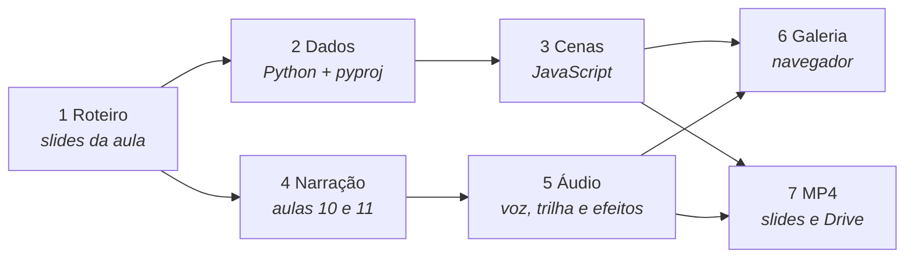
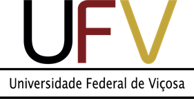
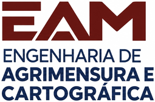

<p align="center">
  
</p>

<h1 align="center">Projeções Cartográficas em movimento</h1>

<p align="center">
  <b>EAM 431, Projeções Cartográficas | Engenharia de Agrimensura e Cartográfica | UFV</b><br>
  Animações e vídeos narrados das aulas teóricas, desenhados a partir das equações das projeções.<br>
  Prof. Dr. Darlan Miranda Nunes
</p>

<p align="center">
  <a href="https://darlanmnunes.github.io/map-projections-repo/"><b>Assistir no navegador</b></a> |
  <a href="#conteúdo">Vídeos por aula</a> |
  <a href="#como-citar">Como citar</a> |
  <a href="https://github.com/darlanmnunes/map-projections-repo/releases">Versões</a>
</p>

<p align="center">
  <a href="https://github.com/darlanmnunes/map-projections-repo/releases/latest"></a>
  <a href="https://darlanmnunes.github.io/map-projections-repo/"></a>
  
  <a href="https://doi.org/10.5281/zenodo.24574295"></a>
  
</p>

---

## Sobre

Este repositório reúne os vídeos animados usados nas aulas teóricas de EAM 431.
Os vídeos das aulas 08 e 09 duram de 50 s a 75 s; os das aulas 10 e 11, narrados, de 2 a 4 min. Cada um
foi feito para entrar num slide ou acompanhar a aula e mostrar, em movimento,
uma ideia que é difícil de ver numa figura parada: um cilindro que gira até virar a
Transversa de Mercator, um cone que se desenrola num setor, um círculo da esfera que
continua círculo no plano.

Três princípios guiam todos os vídeos:

- **Geometria exata.** Toda curva, reticulado e indicatriz na tela é calculada pelas
  equações da projeção (esfera ou elipsoide GRS80), nunca desenhada à mão. O globo 3D é
  uma projeção ortográfica calculada, com descarte do hemisfério oculto.
- **Números conferidos.** Cada vídeo tem um script Python que recalcula, com `pyproj` e
  `numpy`, todos os valores que aparecem na tela e os compara com os slides.
- **Reprodutível.** O vídeo é código: qualquer instante é uma função do tempo, e o MP4 é
  gerado quadro a quadro a partir do repositório.

## Conteúdo

Clique numa aula para ver os vídeos.

<details>
<summary><b>Aula 08 - Projeções Conformes</b></summary>

| Vídeo | Tema | Slides | Duração |
|---|---|---|---|
| [V1](aulas/aula08_projecoes_conformes/v01_conforme_x_equivalente/) | Conforme × equivalente: o que acontece com um círculo infinitesimal | 3 e 4 | 50 s |
| [V2](aulas/aula08_projecoes_conformes/v02_latitude_isometrica/) | Latitude isométrica: do retângulo ao quadrado | 5 | 55 s |
| [V3](aulas/aula08_projecoes_conformes/v03_cilindro_cone_plano/) | Uma família, três superfícies: cilindro, cone e plano | 8 e 9 | 65 s |
| [V4](aulas/aula08_projecoes_conformes/v04_lambert_1pp_2pp/) | Lambert com 1 e 2 paralelos padrão: do cone tangente ao secante | 11 a 13 | 65 s |
| [V5](aulas/aula08_projecoes_conformes/v05_loxodromia_ortodromia/) | Loxodromia × ortodromia: São Paulo → Joanesburgo | 17 e 18 | 60 s |
| [V6](aulas/aula08_projecoes_conformes/v06_estereografica_ups/) | Estereográfica: perspectiva do antípoda e o plano secante do UPS | 20 e 21 | 60 s |
| [V7](aulas/aula08_projecoes_conformes/v07_mercator_tm_utm/) | Da Mercator à Transversa de Mercator e ao UTM | 22 a 24 | 72 s |
</details>

<details>
<summary><b>Aula 09 - Sistemas de Projeção Transversa de Mercator (TM, UTM, RTM e LTM)</b></summary>

| Vídeo | Tema | Slides | Duração |
|---|---|---|---|
| [V1](aulas/aula09_sistemas_tm/v01_fusos_utm/) | 60 fusos: do globo ao fuso de Viçosa | 7 a 13 | 62 s |
| [V2](aulas/aula09_sistemas_tm/v02_coordenadas_planas/) | Coordenadas planas do fuso: origem, falso leste e falso norte | 10 e 11 | 62 s |
| [V3](aulas/aula09_sistemas_tm/v03_fator_escala/) | Fator de escala no fuso UTM e linhas de secância | 15 a 17 | 65 s |
| [V4](aulas/aula09_sistemas_tm/v04_convergencia_meridiana/) | Convergência meridiana: norte de quadrícula × norte geográfico | 19 e 20 | 66 s |
| [V5](aulas/aula09_sistemas_tm/v05_utm_rtm_ltm/) | UTM, RTM e LTM: a mesma TM com outros parâmetros | 24 a 27 | 65 s |
</details>

<details>
<summary><b>Aula 10 - Transporte de coordenadas UTM (problemas direto e inverso) - vídeos narrados</b></summary>

| Vídeo | Tema | Slides | Duração |
|---|---|---|---|
| [V1](aulas/aula10_transporte_coordenadas/v01_terreno_grade/) | Do terreno à grade: por que transportar coordenadas | 3 e 5 | 2 min 47 s |
| [V2](aulas/aula10_transporte_coordenadas/v02_reducoes_lineares/) | Reduções lineares: Fₕ, m₁₂ e o fator combinado | 6 a 8 | 2 min 31 s |
| [V3](aulas/aula10_transporte_coordenadas/v03_geodesica_corda_psi/) | Geodésica projetada, corda e a redução angular ψ | 9 e 10 | 2 min 08 s |
| [V4](aulas/aula10_transporte_coordenadas/v04_problema_direto/) | Problema direto, passo a passo (Viçosa e UFPR) | 12, 14, 16, 17 e 20 | 2 min 37 s |
| [V5](aulas/aula10_transporte_coordenadas/v05_problema_inverso/) | Problema inverso, contra-azimute e os três arcos da UFPR | 11, 15 e 18 | 2 min 47 s |
| [V6](aulas/aula10_transporte_coordenadas/v06_quanto_vale/) | Quanto vale cada correção e quando simplificar | 19, 22 e 23 | 2 min 20 s |
</details>

<details>
<summary><b>Aula 11 - Sistemas de coordenadas locais - vídeos narrados</b></summary>

| Vídeo | Tema | Slides | Duração |
|---|---|---|---|
| [V1](aulas/aula11_sistemas_locais/v01_por_que_plano_local/) | Por que coordenadas locais e até onde vale o plano | 3 a 5, 7 e 17 a 20 | 3 min 14 s |
| [V2](aulas/aula11_sistemas_locais/v02_terna_topocentrica/) | Do geocêntrico ao topocêntrico: a matriz T | 14 a 16 e 22 | 3 min 53 s |
| [V3](aulas/aula11_sistemas_locais/v03_utm_para_plano_local/) | Do UTM ao plano local: rigoroso, similaridade e polar | 26 a 29 e 31 a 35 | 3 min 37 s |
</details>

Cada pasta tem um README com o objetivo didático, as cenas, as equações usadas e a tabela
de conferência dos números.

## Como um vídeo é feito

Cada vídeo nasce de um roteiro e é código do começo ao fim: o Python calcula e confere os
números, o JavaScript desenha cada instante, e o mesmo código serve à galeria e ao MP4.



1. **Roteiro.** O que o vídeo precisa mostrar, cena a cena, a partir dos slides (`roteiro.md`).
2. **Dados.** `python/gerar_dados.py` calcula com `pyproj` e `numpy` as curvas, os reticulados e
   os valores que aparecem na tela, confere cada um com os slides e grava `motion/vN-dados.json`.
3. **Cenas.** Cada cena é um arquivo `motion/scene-<id>.js`: `init()` monta os elementos e
   `render(t)` desenha o instante `t`. Nada é desenhado à mão.
4. **Narração.** Nos vídeos narrados, o texto de cada fala fica em `motion/voz/narracao.json`;
   a voz é sintetizada, cortada fala a fala e conferida por transcrição (`ferramentas/narracao/`).
5. **Áudio.** `ferramentas/montar_audio.py` acerta a duração das cenas pelas falas e mistura a
   narração, a trilha (que abaixa sob a voz) e os efeitos em `motion/audio.mp3`.
6. **Galeria.** O navegador executa as cenas na hora, com barra de tempo e som; nada é
   pré-renderizado.
7. **MP4.** `ferramentas/renderizar_mp4.py` grava o vídeo quadro a quadro (1920 × 1080, 30 fps)
   para os slides e o Drive da disciplina.

## Galeria no navegador

A galeria está em **https://darlanmnunes.github.io/map-projections-repo/**. Cada aula é um menu
que se expande com todos os seus vídeos; a mais recente abre aberta, e um endereço com
`#aula11` (como nos botões dos slides) abre a aula correspondente. Cada cartão mostra uma
miniatura desenhada ao vivo e abre o vídeo no player, com barra de tempo, pausa na barra de
espaço e som que pode ser desligado.

---

## Para quem mantém o repositório

<details>
<summary><b>Como o repositório está organizado</b></summary>

| Pasta ou arquivo | Conteúdo |
| --- | --- |
| `index.html` | Galeria, página inicial do GitHub Pages; a lista `AULAS` define aulas e vídeos |
| `aulas/aulaNN_tema/` | Uma pasta por aula, com `README.md` e, quando há, `comum/` (código compartilhado pelos vídeos) |
| `aulas/aulaNN_tema/vNN_tema/` | Uma pasta por vídeo: `README.md`, `roteiro.md`, `python/` e `motion/` |
| `…/motion/` | `scenes.json` (cenas, durações, trilha), `shared.js`, `scene-*.js`, `base.css`, dados JSON, `voz/` e `audio.mp3` |
| `…/export/` | MP4 renderizado; fica fora do git |
| `ferramentas/preview/` | Player usado pela galeria e pelo renderizador |
| `ferramentas/identidade/` | Moldura comum dos vídeos e logotipos institucionais |
| `ferramentas/audio/` | Trilha da série e efeitos sonoros, com os créditos |
| `ferramentas/narracao/` | Síntese da voz, corte em falas, conferência e quadros de revisão |
| `ferramentas/montar_audio.py`, `renderizar_mp4.py` | Faixa de áudio dos vídeos narrados e renderização em MP4 |
| `.github/workflows/pages.yml` | Publicação da galeria a cada push em `main` |

Os MP4 finais ficam no Google Drive da disciplina; o repositório guarda o código que os gera.
</details>

<details>
<summary><b>Rodar e renderizar no computador</b></summary>

Requisitos: Python 3.9 ou mais recente com `numpy`, `scipy`, `shapely`, `pyogrio` e `pyproj`,
além de Google Chrome e ffmpeg para o MP4.

```bash
# dados e conferência dos números de um vídeo
python aulas/aula08_projecoes_conformes/v07_mercator_tm_utm/python/gerar_dados.py

# galeria e player no navegador, a partir da raiz do repositório
python -m http.server 8000
# http://localhost:8000/  ou  http://localhost:8000/ferramentas/preview/?v=aulas/aula08_projecoes_conformes/v07_mercator_tm_utm

# MP4 em export/ (--sem-som para vídeo mudo)
python ferramentas/renderizar_mp4.py aulas/aula08_projecoes_conformes/v07_mercator_tm_utm
```
</details>

<details>
<summary><b>Vídeos narrados</b></summary>

```bash
TTS_ENGINE=<caminho do audio.mjs> python ferramentas/narracao/gerar_voz.py aulas/<aula>/<vídeo> gemini-2.5-flash-preview-tts
python ferramentas/narracao/qa_voz.py aulas/<aula>/<vídeo>      # transcreve cada fala e compara com o texto
python ferramentas/narracao/palavras.py aulas/<aula>/<vídeo>    # instante de cada palavra
python ferramentas/montar_audio.py aulas/<aula>/<vídeo>         # durações das cenas e audio.mp3
```

Uma só requisição de voz por vídeo (voz Charon); o áudio é cortado nas pausas entre as falas e
cada corte é conferido por transcrição. As cenas sincronizam os elementos com as palavras por
`kit.em('fala', 'palavra')`. Detalhes em [ferramentas/narracao/README.md](ferramentas/narracao/README.md).
</details>

<details>
<summary><b>Identidade visual e som</b></summary>

| Elemento | Padrão |
| --- | --- |
| Moldura | Três traços nas cores da UFV no canto superior esquerdo; "EAM 431 \| Projeções Cartográficas \| 2026" e "Prof. Dr. Darlan M. Nunes" no direito (`ferramentas/identidade/moldura.css`) |
| Cores | Fundo branco; azul-marinho `#1F3864` (elementos e equações); azul `#0432FF` (títulos); laranja `#E8711A` (destaques); cinza `#9A9A9A` (meridianos e paralelos); vermelho `#C0392B` a 55 % (indicatrizes de Tissot) |
| Tipografia | Arimo (mesma métrica do Arial dos slides) e STIX Two Text nas equações |
| Notação | φ, λ, λ₀, ψ, m, σ, ϖ, k₀, ρ e γ; "sen" em vez de "sin"; x para leste e y para norte |
| Trilha | Uma só para a série, sóbria, sem sons de natureza: "Ambient Piano Guitar Texture E", de deadrobotmusic (Freesound, CC0); cada vídeo usa um trecho diferente |
| Narração e efeitos | Voz sintetizada (Gemini TTS, Charon), um professor explicando com calma; efeitos curtos sintetizados por código, sincronizados com as palavras |

Créditos em [ferramentas/audio/CREDITOS.md](ferramentas/audio/CREDITOS.md). Linhas de costa e
limites: Natural Earth 1:110m e 1:50m (domínio público).
</details>

<details>
<summary><b>Acrescentar uma aula ou um vídeo</b></summary>

1. Crie `aulas/aulaNN_tema/vNN_tema/` com `roteiro.md`, `python/gerar_dados.py` e `motion/`
   (a forma mais rápida é copiar um vídeo parecido).
2. Gere os dados, confira os números e veja o vídeo no player.
3. Acrescente o vídeo à lista `AULAS` do `index.html` (uma aula nova é um item novo da lista) e
   à tabela de [Conteúdo](#conteúdo).
4. Faça o push: o workflow publica a galeria. Para uma versão nova com DOI, publique um release.
</details>

---

## Como citar

Nunes, D. M. (2026). *Projeções Cartográficas em movimento: animações e vídeos narrados da disciplina
EAM 431, Projeções Cartográficas (UFV)* (versão 1.0.1) [Software]. Zenodo.
https://doi.org/10.5281/zenodo.24574295

O DOI acima vale para todas as versões e leva sempre à mais recente. Para citar só a versão 1.0.1, use
[10.5281/zenodo.24574296](https://doi.org/10.5281/zenodo.24574296). Os metadados estão em
[CITATION.cff](CITATION.cff) e no botão "Cite this repository" do GitHub.

## Autor

Prof. Dr. Darlan Miranda Nunes ([ORCID 0000-0001-5566-7919](https://orcid.org/0000-0001-5566-7919)),
Departamento de Engenharia Civil, Setor de Engenharia de Agrimensura e Cartográfica,
Universidade Federal de Viçosa.

## Licença

- **Código** (Python, JavaScript, CSS e HTML, inclusive `ferramentas/` e as pastas `python/` e
  `motion/` de cada vídeo): licença MIT, em [LICENSE](LICENSE).
- **Conteúdo didático** (os vídeos, roteiros, textos das narrações, faixas de áudio e READMEs das
  aulas): [CC BY-NC 4.0](https://creativecommons.org/licenses/by-nc/4.0/deed.pt-br), em
  [LICENSE-CONTEUDO](LICENSE-CONTEUDO), a mesma licença dos slides da disciplina.
- **Fora das licenças**: os logotipos da UFV e da Engenharia de Agrimensura e Cartográfica
  (`ferramentas/identidade/logos/`, uso restrito à identificação institucional), a trilha
  (CC0, de deadrobotmusic) e os contornos do Natural Earth (domínio público).

Detalhes em [NOTICE](NOTICE).

---

<p align="center">
  &nbsp;&nbsp;&nbsp;
  
</p>

<p align="center">
  Engenharia de Agrimensura e Cartográfica | Departamento de Engenharia Civil | Universidade Federal de Viçosa<br>
  Desenvolvido por <b>Prof. Dr. Darlan Miranda Nunes</b>
</p>
